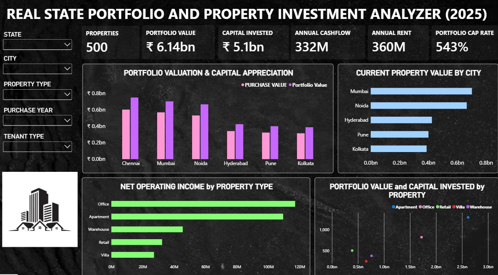

# Real Estate Portfolio & Property Investment Analyzer

## Overview

## Project Preview

The **Real Estate Portfolio & Property Investment Analyzer** is a data analytics project developed using Microsoft Excel and Microsoft Power BI to evaluate real estate investments and analyze property portfolio performance.

Using a dataset of 500 properties, the project explores investment returns, geographical distribution, acquisition costs, operating expenses, financial trends, and property valuations. The interactive Power BI dashboard transforms property-related data into meaningful visual insights to support investment evaluation and data-driven decision-making.

## Dashboard Overview

The Power BI dashboard consists of five interactive analytical pages:

### 1. Real Estate Portfolio & Property Investment
Provides an overview of the real estate portfolio, highlighting key investment metrics and overall portfolio performance.

### 2. Investment & Geographical Performance
Analyzes investment distribution and property performance across different geographical locations.

### 3. Acquisition & Expenses
Examines property acquisition costs and associated expenses to provide insights into the cost structure of the portfolio.

### 4. Financial Trends & Vendor Analysis
Explores financial trends and vendor-related information to support a better understanding of portfolio-related financial data.

### 5. Property Performance, Valuation & Rankings
Evaluates individual property performance, examines property valuations, and compares properties through performance rankings.

## Tools & Technologies

- **Microsoft Excel** — Dataset management and data preparation.
- **Microsoft Power BI** — Interactive dashboards, data visualization, and analytical reporting.

## Project Objectives

- Analyze real estate investment and property portfolio data.
- Explore geographical investment distribution and property performance.
- Examine acquisition costs, operating expenses, and financial trends.
- Evaluate property valuations and comparative rankings.
- Present property-related information through interactive visualizations to support data-driven analysis.

## Key Highlights

- Analysis of a dataset containing 500 properties.
- Five interactive Power BI dashboard pages.
- Integration of Excel-based data with Power BI visualizations.
- Exploration of investment, financial, geographical, and property performance metrics.

## Project Files

- **Power BI Dashboard:** `dashboard.pbix`
- **Dataset:** Excel workbook containing the property data.
- **Project Documentation:** Description and supporting project visuals.

## How to Use

1. Download or clone this repository.
2. Open `dashboard.pbix` using Microsoft Power BI Desktop.
3. If prompted, configure the data source to point to the downloaded Excel dataset.
4. Refresh the data if necessary.
5. Explore the five dashboard pages and their available interactive features.

## Conclusion

This project demonstrates the practical application of Excel and Power BI in real estate data analytics. By combining structured data preparation with interactive visualization, it provides a consolidated view of property investments, expenses, financial trends, valuations, and performance to facilitate informed analysis.

## Credits

Credit the original project creator and acknowledge the dataset source, where applicable.
